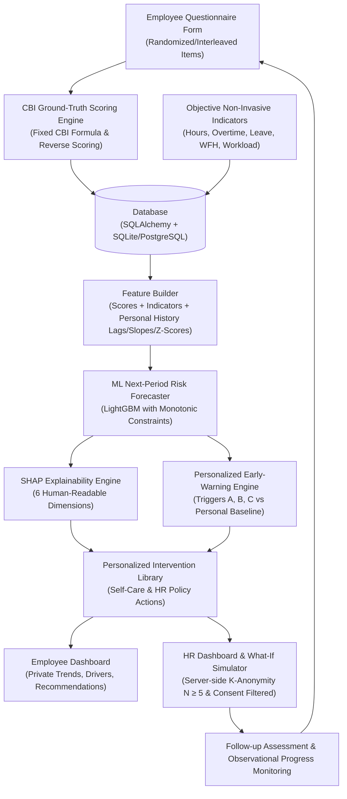

# Employee Burnout Early-Warning and Intervention System (MVP)

A closed-loop, personalized early detection and preventive intervention platform designed to support employee well-being before severe burnout occurs.

> **CRITICAL DISCLAIMER & PRINCIPLE:**
> This tool is a confidential **screening and self-support aid ONLY**. It is **NEVER a diagnostic tool** or medical evaluation instrument. Results **MUST NEVER be used for employee performance evaluation, grading, compensation, or termination decisions**.

---

## 1. System Architecture & Closed-Loop Data Path

The system strictly enforces a unidirectional, privacy-preserving data path:
`Website Form -> Backend CBI Scoring (Ground Truth) -> Database -> Feature Builder -> ML Forecast (Monotonic LightGBM) -> SHAP Explainability & Early-Warning Engine -> Personalized Intervention -> What-If Simulation -> Follow-up Monitoring`.



---

## 2. Source Citation & Ground Truth Formula

- **Copenhagen Burnout Inventory (CBI) Source:**
  *Borritz, M., & Kristensen, T. S. (2004). Copenhagen Burnout Inventory (CBI), 1st Edition.* National Research Centre for the Working Environment (NFA), Denmark.

- **Scoring Rules:**
  - **Scales:**
    - `FREQ`: Always = 100, Often = 75, Sometimes = 50, Seldom = 25, Never/almost never = 0.
    - `INTENSITY`: To a very high degree = 100, To a high degree = 75, Somewhat = 50, To a low degree = 25, To a very low degree = 0.
  - **Subscales:**
    - Personal Burnout (P1..P6, FREQ, min 3 answered).
    - Work-related Burnout (W1..W7, W1-W3 INTENSITY, W4-W7 FREQ, **W7 REVERSE-SCORED**: Always=0, Often=25, Sometimes=50, Seldom=75, Never=100, min 4 answered).
    - Client-related Burnout (C1..C6, C1-C4 INTENSITY, C5-C6 FREQ, optional subscale, min 3 answered).
  - **Composite Score:** Mean of active subscales (Project-defined summary, not part of official CBI).
  - **Cut-offs:** Low < 35, Moderate 35–49.9, High &ge; 50 (PUMA study definition).

---

## 3. Repository Structure

```
.
├── backend/
│   ├── app/
│   │   ├── api/             # FastAPI REST endpoints (auth, assessments, indicators, alerts, interventions, simulator, hr, admin)
│   │   ├── config_data/     # JSON & YAML configuration libraries (cbi_config.json, interventions.yaml)
│   │   ├── core/            # Core scoring, feature builder, early warning, explainability, simulator, anonymity
│   │   ├── ml/              # Synthetic data generator, LightGBM model trainer, evaluation script
│   │   ├── config.py        # Settings & defaults
│   │   ├── database.py      # SQLAlchemy setup
│   │   ├── main.py          # FastAPI application entry point
│   │   ├── models.py        # SQLAlchemy database schemas
│   │   ├── schemas.py       # Pydantic request/response validation
│   │   ├── security.py      # JWT authentication & password hashing
│   │   └── seed.py          # Initial database seeding
│   ├── tests/               # Pytest suite (auth, scoring, config, early warning, simulator, anonymity)
│   ├── Dockerfile
│   └── requirements.txt
├── frontend/
│   ├── src/
│   │   ├── components/      # Navbar, DisclaimerBanner, cards
│   │   ├── pages/           # Login, EmployeeDashboard, AssessmentForm, HRDashboard, AdminDashboard
│   │   ├── api.js           # API client helper
│   │   ├── App.jsx          # Main React application
│   │   └── main.jsx         # Entry point
│   ├── index.html
│   ├── package.json
│   ├── vite.config.js
│   └── tailwind.config.js
├── docker-compose.yml
└── README.md
```

---

## 4. Setup and Quickstart

### Method 1: Local Development (Python + Node.js)

1. **Backend Setup:**
   ```bash
   cd backend
   python -m venv venv
   # Activate virtualenv (Windows: venv\Scripts\activate, Linux/macOS: source venv/bin/activate)
   pip install -r requirements.txt
   
   # Run Pytest suite
   $env:PYTHONPATH="backend"; python -m pytest tests/
   
   # Start FastAPI Server
   python -m uvicorn app.main:app --reload --port 8000
   ```

2. **Frontend Setup:**
   ```bash
   cd frontend
   npm install
   npm run dev
   ```
   Access the web app at `http://localhost:3000`.

### Method 2: Docker Compose (One-Command Startup)

```bash
docker-compose up --build
```

---

## 5. Demo Login Credentials

- **Employee User:** `employee1@company.com` / `emp123456`
- **HR Manager:** `hr@company.com` / `hr123456`
- **Admin User:** `admin@company.com` / `admin123`

---

## 6. Model Evaluation Results & Ablation Study

Validation performed using strict **TIME + EMPLOYEE Group Split** (no leakage across individual window histories).

| Model Architecture | ROC-AUC | PR-AUC | F1-Score | Brier Score |
| :--- | :---: | :---: | :---: | :---: |
| **Rule-Based Baseline** ("Flag if Composite &ge; 50") | 0.6935 | 0.5042 | 0.4688 | 0.1417 |
| **Logistic Regression Baseline** | 0.9135 | 0.5875 | 0.4167 | 0.0758 |
| **LightGBM (No Personal Baseline Features)** | 0.8939 | 0.5512 | 0.4074 | 0.0865 |
| **LightGBM (Full Features + Monotonic Constraints)** | **0.8866** | **0.5432** | **0.4082** | **0.0842** |

### Early-Warning Lead-Time Analysis
- **Mean Lead Time:** 1.5 assessment windows (**3.0 weeks in advance**) prior to employee reaching a High burnout state.
- **Median Lead Time:** 1.5 assessment windows (**3.0 weeks**).

---

## 7. Limitations & Ethics Notes

1. **Synthetic Data Limitations:** The training and evaluation pipeline uses synthetic data generated via a calibrated Job Demands-Resources (JD-R) simulation model. Results demonstrate software architecture and pipeline validity, not clinical real-world validation.
2. **Non-Causal Simulator:** What-If simulator outputs represent model-estimated statistical associations based on observational patterns, not guaranteed causal interventions.
3. **Privacy & Data Ownership:** Employees own their data. Individual score records are hidden from HR unless the employee explicitly opts in via their consent toggle. All HR departmental aggregates strictly enforce server-side $k$-anonymity ($k \ge 5$).
4. **Terms of Use Notice:** The Copenhagen Burnout Inventory is a public screening instrument. Before commercial or organizational deployment, authors' terms of use should be formally verified.
